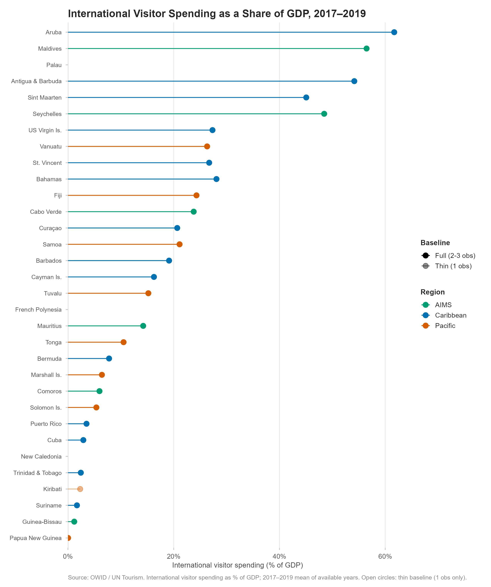
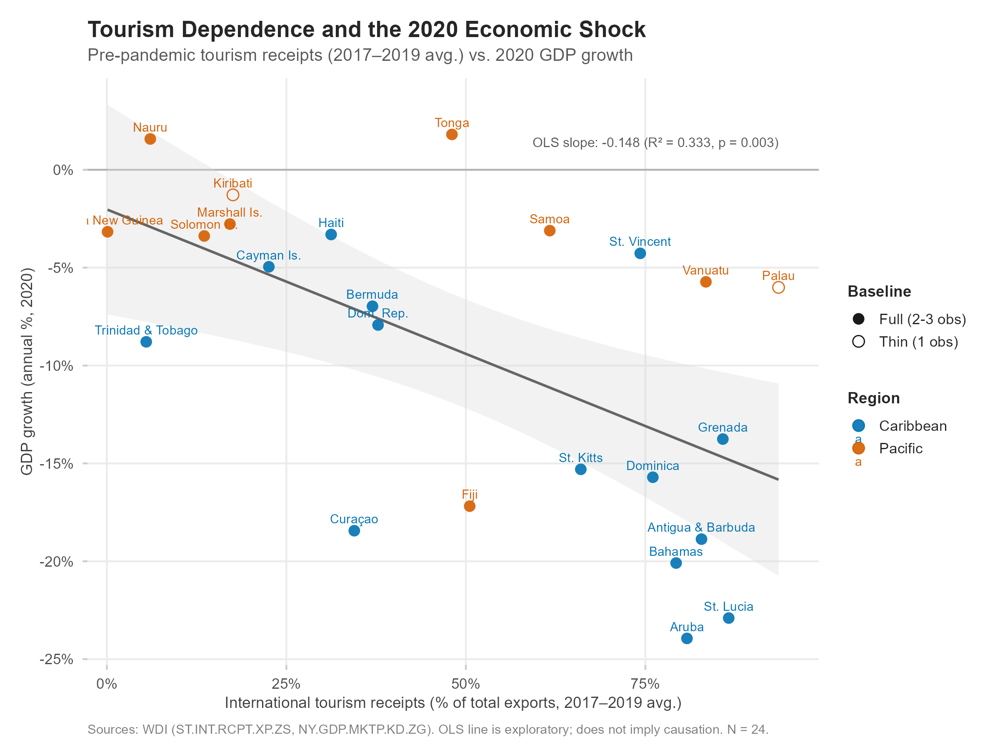
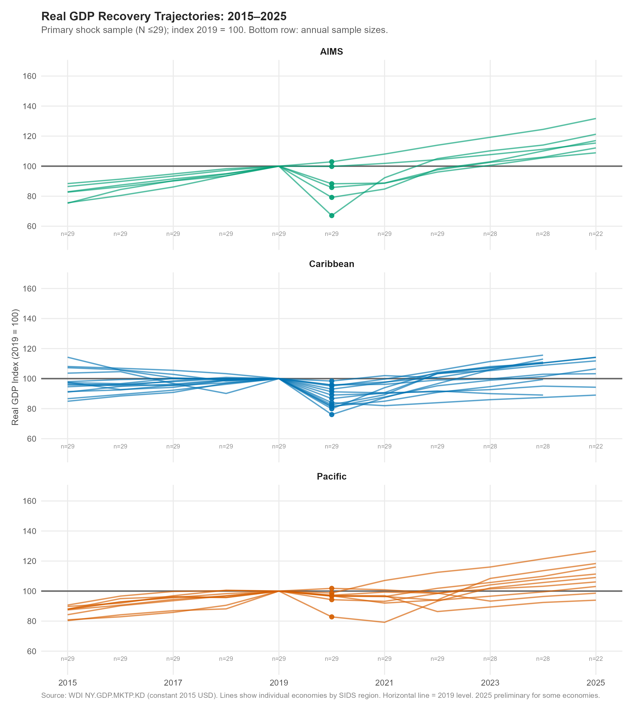
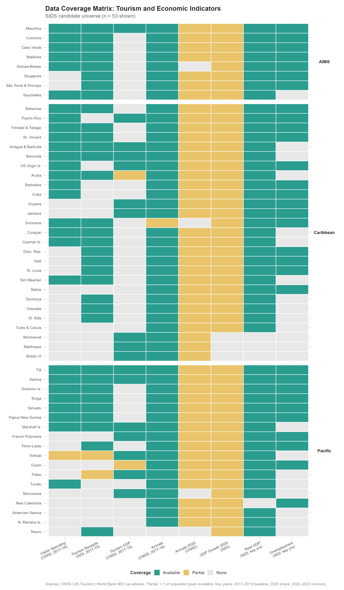
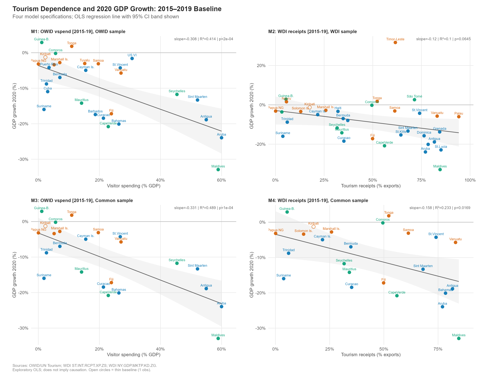
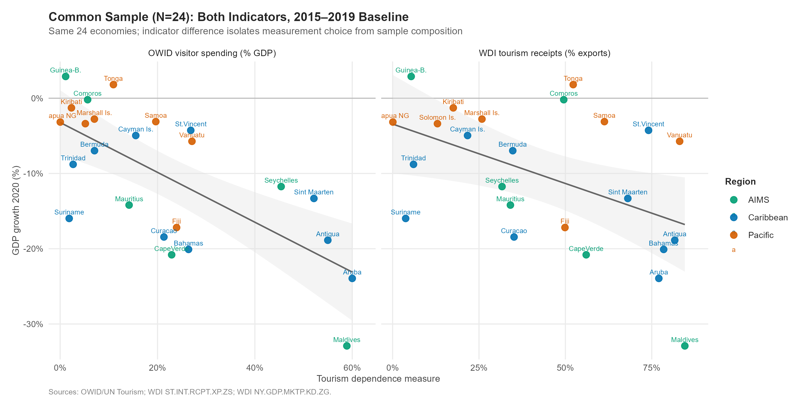
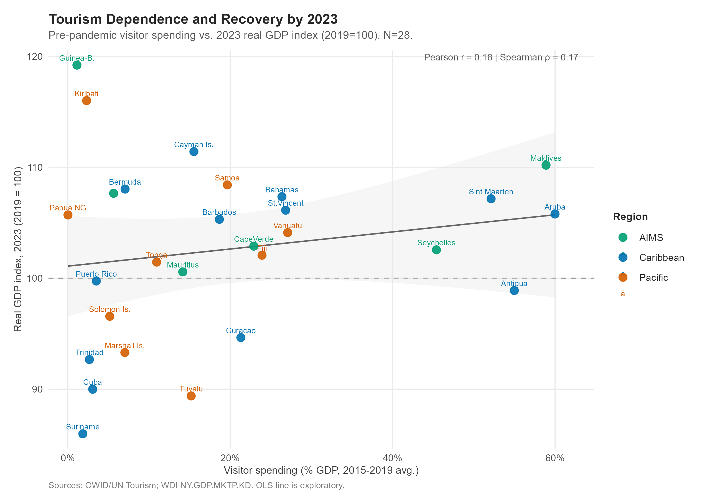

# Island Time, Interrupted

### Tourism Dependence and the COVID Cliff in Small Island Developing States

*When international travel stopped, how did tourism-dependent island economies fare — and what happened next?*

Small island economies built around international tourism faced an involuntary stress test in 2020. This project examines whether pre-pandemic tourism dependence predicted the severity of the 2020 economic shock across Caribbean, Pacific, and AIMS small island developing states — and then traces the recovery through the most recent available data.

**The central finding:** Across 29 economies in the primary sample, each additional percentage point of visitor spending relative to GDP was associated with roughly 0.31 percentage points of additional GDP contraction in 2020 (R² ≈ 0.41, p < 0.001). The association holds across baseline windows, samples, and after excluding the most influential observation (Maldives). A second indicator — WDI tourism receipts as a share of exports — shows a weaker and less consistent signal.

**The qualification:** By 2023, most economies had returned to 2019 real GDP levels. Tourism dependence was not significantly associated with the 2023 recovery index (Pearson r = 0.18, p = 0.36). The same exposure that drove the initial contraction also drove the rebound once travel resumed.

---

## Published Site

> ### 🏝️ [johbry17.github.io/Island-Time-Interrupted](https://johbry17.github.io/Island-Time-Interrupted/)

| Page | Content |
|------|---------|
| [Field Note](https://johbry17.github.io/Island-Time-Interrupted/index.html) | Narrative overview: question, findings, figures, conclusion |
| [Analysis](https://johbry17.github.io/Island-Time-Interrupted/analysis.html) | Full technical results: all 8 models, diagnostics, recovery analysis |
| [Data Dictionary](https://johbry17.github.io/Island-Time-Interrupted/data-dictionary.html) | Sources, indicator definitions, coverage, and limitations |
| [Methodology](https://johbry17.github.io/Island-Time-Interrupted/methodology.html) | Research design, sample construction, specifications, reproducibility |

---

## Table of Contents

- [Project Overview](#project-overview)
- [Key Findings](#key-findings)
- [Research Design](#research-design)
- [Data Sources](#data-sources)
- [Figures](#figures)
- [Tools and Technologies](#tools-and-technologies)
- [Pipeline and Reproducibility](#pipeline-and-reproducibility)
- [Repository Structure](#repository-structure)
- [Limitations](#limitations)
- [References](#references)
- [Author](#author)

---

## Project Overview

The COVID-19 pandemic disrupted international travel at an unprecedented scale: global tourist arrivals fell by roughly 74 percent in 2020. For many countries, this was a significant but manageable sector-level disruption. For small island economies where international tourism accounts for a large fraction of total economic activity, the interruption of travel was something closer to the suspension of the primary economic engine.

This project uses data from 58 candidate economies across the Caribbean, the Pacific, and the AIMS region (Atlantic, Indian Ocean, Mediterranean, and South China Sea) to examine whether the degree of pre-pandemic tourism dependence predicted the severity of the 2020 economic shock. It then traces the recovery through 2023–2025 using real GDP data from the World Bank.

The analysis uses two indicators of tourism dependence: international visitor spending as a share of GDP (primary, from OWID/UN Tourism) and international tourism receipts as a share of total exports (complementary, from the World Bank WDI). These two measures capture related but distinct concepts and have different data coverage; using them separately reveals that the choice of indicator matters for how clearly the pattern can be seen.

This is an exploratory cross-sectional analysis. It documents associations; it does not establish causal explanations of national economic trajectories.

---

## Key Findings

### The 2020 shock

- **Primary indicator (OWID visitor spending):** Strong, consistent negative association between pre-pandemic tourism dependence and 2020 GDP growth. Each percentage point increase in visitor spending as a share of GDP was associated with approximately 0.31 percentage points of additional GDP contraction (R² ≈ 0.41–0.49, Pearson r ≈ −0.64 to −0.70, p < 0.001).
- The result holds across two baseline windows (2015–2019 primary; 2017–2019 sensitivity), two samples (full OWID, N=29; common sample, N=24), and after excluding the Maldives (the most influential observation).
- **Complementary indicator (WDI receipts/exports):** Weaker and inconsistent results. In the full WDI sample (N=35), p ≈ 0.06; in the common sample (N=24), R² ≈ 0.23, p ≈ 0.02.

### The recovery

- **19 of 28** economies with 2023 data had returned to or exceeded their 2019 aggregate real GDP.
- **17 of 28** had recovered real GDP per capita — two fewer, reflecting population dynamics: four economies (Comoros, PNG, Seychelles, Vanuatu) recovered aggregate but not per-capita; two (Marshall Islands, Puerto Rico) recovered per-capita but not aggregate.
- Pre-pandemic tourism dependence was **not significantly associated** with the 2023 recovery index (Pearson r = 0.18, p = 0.36). Tourism-dependent economies contracted more sharply in 2020 and bounced back more strongly from 2021 — the shock and rebound share the same mechanism.

---

## Research Design

| Dimension | Description |
|-----------|-------------|
| Unit of analysis | Country-year; cross-sectional summary at country level |
| Candidate universe | 58 SIDS and associated economies (UN-OHRLLS list) |
| Primary shock sample | 29 economies with OWID vspend baseline and 2020 GDP growth |
| Shock outcome | 2020 GDP growth (%), WDI NY.GDP.MKTP.KD.ZG |
| Primary tourism measure | OWID visitor spending (% GDP), 2015–2019 mean |
| Complementary measure | WDI receipts (% total exports), 2015–2019 mean |
| Statistical approach | Bivariate OLS; Pearson and Spearman correlation |
| Multiple-testing | Holm correction across 8 principal p-values |
| Diagnostics | Cook's distance; coverage-restricted sensitivity |
| Recovery outcome | Real GDP index, 2019 = 100 (NY.GDP.MKTP.KD) |

Eight principal shock models are estimated: two indicators × two samples (full vs. common) × two baseline windows (2015–2019 and 2017–2019). All results are reported; no specification is selected on the basis of its p-value.

---

## Data Sources

| Dataset | Source | Indicator | Years |
|---------|--------|-----------|-------|
| Visitor spending (% GDP) | [OWID / UN Tourism](https://ourworldindata.org/grapher/spending-by-international-visitors-while-visiting-a-country-as-a-share-of-gdp) | Not a single WDI code | 1995–2024 |
| Tourism direct GDP (% GDP) | [OWID / UN Tourism](https://ourworldindata.org/grapher/tourism-gdp-proportion-of-total-gdp) | SDG 8.9.1 (TSA method) | 2008–2023 |
| Tourist arrivals | [OWID / UN Tourism](https://ourworldindata.org/grapher/international-tourist-trips) | Count | 1995–2024 |
| Tourism receipts (% exports) | [WDI ST.INT.RCPT.XP.ZS](https://data.worldbank.org/indicator/ST.INT.RCPT.XP.ZS) | % total exports | ~1995–2020† |
| Real GDP | [WDI NY.GDP.MKTP.KD](https://data.worldbank.org/indicator/NY.GDP.MKTP.KD) | Constant 2015 USD | 2008–2025 |
| Real GDP per capita | [WDI NY.GDP.PCAP.KD](https://data.worldbank.org/indicator/NY.GDP.PCAP.KD) | Constant 2015 USD | 2008–2025 |
| GDP growth | [WDI NY.GDP.MKTP.KD.ZG](https://data.worldbank.org/indicator/NY.GDP.MKTP.KD.ZG) | Annual % | 2008–2025 |

† The WDI tourism receipts series contains no observations beyond 2020 in this retrieval. This appears to reflect a change in UN Tourism data dissemination rather than a simple publication lag.

> **Important:** OWID visitor spending (% GDP) is sourced from UN Tourism statistics and World Bank national accounts. It is not equivalent to WDI `ST.INT.XPND.GD.ZS` or any other single WDI code. Do not conflate it with tourism direct GDP (SDG 8.9.1), which measures domestic value added rather than visitor expenditure.

---

## Figures

| Figure | Description |
|--------|-------------|
|  | Pre-pandemic tourism dependence rankings (primary shock sample) |
|  | Tourism dependence vs. 2020 GDP growth |
|  | Real GDP recovery trajectories, 2015–2025 |
|  | Data coverage matrix across the candidate universe |
|  | Four-panel model comparison (2015–2019 baseline) |
|  | Common-sample indicator comparison |
|  | 2023 recovery index vs. pre-pandemic tourism dependence |

---

## Tools and Technologies

- **R 4.4.1** — data acquisition, analysis, and visualization
- **Quarto** — reproducible HTML publication (four-page site)
- **GitHub Pages** — site hosting (`docs/` branch)
- **wbstats** — World Bank API retrieval
- **tidyverse** — data manipulation and visualization
- **ggplot2** / **patchwork** — publication-quality figures
- **here** — project-root-aware file paths
- **svglite** — SVG figure export

---

## Pipeline and Reproducibility

### Prerequisites

- R ≥ 4.4.0
- Quarto ≥ 1.4
- R packages:

```r
install.packages(c("tidyverse", "wbstats", "here", "scales",
                   "knitr", "rmarkdown", "patchwork", "svglite"))
```

### Execution order

Run from the **repository root** (where `.git` is located). `here()` anchors paths automatically.

```r
source("R/01_data_acquisition.R")   # ~2-3 min; calls World Bank API
source("R/02_data_quality.R")       # coverage matrix, baselines
source("R/03_preliminary_eda.R")    # preliminary figures
source("R/04_shock_models.R")       # 8-model shock analysis
source("R/05_recovery_analysis.R")  # recovery trajectories
```

### Render the site

```bash
quarto render
```

Renders all four pages to `docs/`. Open `docs/index.html` locally to preview.

> **Note:** R scripts must run before rendering. Quarto pages read pre-computed files from `data/processed/` and `output/`; they do not re-run the R pipeline.

### Data freshness

- OWID CSVs in `data/raw/` are fixed January–July 2026 downloads. To update, replace them with new downloads from the OWID grapher pages.
- WDI data is retrieved programmatically at run time. Re-running `01_data_acquisition.R` will pull the latest WDI data, which may differ from the results here.
- Retrieval date and returned codes are logged in `data/raw/worldbank/wdi_retrieval_metadata.txt`.

---

## Repository Structure

```
Island-Time-Interrupted/
│
├── _quarto.yml                   Site configuration (output: docs/)
├── index.qmd                     Field Note (public overview)
├── analysis.qmd                  Technical analysis
├── data-dictionary.qmd           Data sources and variable reference
├── methodology.qmd               Research design and methods
├── styles.css                    Site stylesheet
├── images/                       Favicon
│
├── R/
│   ├── 01_data_acquisition.R     Load OWID; retrieve WDI via wbstats
│   ├── 02_data_quality.R         Coverage matrix; 2015-19 and 2017-19 baselines
│   ├── 03_preliminary_eda.R      Rankings, measure comparison, preliminary figures
│   ├── 04_shock_models.R         Eight-model shock analysis with diagnostics
│   └── 05_recovery_analysis.R    Recovery index and trajectories
│
├── data/
│   ├── raw/
│   │   ├── international-tourist-trips/
│   │   ├── spending-by-international-visitors-…/
│   │   ├── tourism-gdp-proportion-of-total-gdp/
│   │   └── worldbank/            WDI CSV (retrieved via wbstats)
│   └── processed/                All analytical datasets
│       ├── candidates.csv        58-economy candidate universe
│       ├── analytical_panel.csv  Long-format panel (57 economies, unbalanced)
│       ├── country_coverage.csv  Coverage matrix with sample flags
│       ├── baseline_shock_recovery.csv  Per-economy baselines + outcomes
│       └── recovery_index.csv    2019=100 real GDP index
│
├── output/
│   ├── figures/                  PNG (300 dpi) + SVG figures
│   └── tables/                   CSV model results and recovery summary
│
├── docs/                         Rendered site → GitHub Pages
├── archive/                      Superseded planning documents
├── LICENSE
└── README.md
```

---

## Limitations

1. **Observational, not causal.** This analysis documents cross-sectional associations. It cannot establish that tourism dependence caused the observed contractions.
2. **Small N.** The primary shock sample contains 29 economies. Individual outliers can be influential (particularly the Maldives); all diagnostics are reported.
3. **Annual GDP as outcome.** 2020 annual GDP growth aggregates the full calendar year and does not capture within-year variation, employment, debt, or inequality.
4. **WDI receipts end of series.** The WDI `ST.INT.RCPT.XP.ZS` series contains no observations beyond 2020 in this retrieval. The complementary-indicator analysis is limited to the shock period.
5. **Coverage gaps.** Seven candidate economies (AIA, GLP, MTQ, MSR, BES, COK, NIU) have no World Bank API coverage and do not appear in any analytical sample. Some Pacific micro-states have sparse OWID data.
6. **Recovery measurement.** Aggregate real GDP recovery by 2023 does not capture per-capita recovery, employment recovery, fiscal sustainability, or structural change. The distinction between aggregate and per-capita recovery is documented but not fully analyzed.
7. **2025 data.** Preliminary for 22 of 29 primary-sample economies; cross-economy comparisons at 2025 should be treated cautiously.

---

## References

- UN-OHRLLS. [List of Small Island Developing States](https://www.un.org/ohrlls/content/list-sids). Retrieved November 2026.
- Our World in Data. [Spending by international visitors while visiting a country as a share of GDP](https://ourworldindata.org/grapher/spending-by-international-visitors-while-visiting-a-country-as-a-share-of-gdp).
- Our World in Data. [Tourism contribution to GDP](https://ourworldindata.org/grapher/tourism-gdp-proportion-of-total-gdp).
- Our World in Data. [Arrivals of tourists from abroad](https://ourworldindata.org/grapher/international-tourist-trips).
- World Bank. [World Development Indicators](https://datatopics.worldbank.org/world-development-indicators/).
- UN Tourism. [Tourism Statistics Database](https://www.untourism.int/tourism-statistics/tourism-statistics-database).

---

## Author

**Bryan C. Johns**  
Data Analyst | Portfolio: [github.com/johbry17](https://github.com/johbry17)

---

## License

OWID data: [CC BY 4.0](https://creativecommons.org/licenses/by/4.0/)  
World Bank WDI data: [CC BY 4.0](https://datacatalog.worldbank.org/public-licenses#cc-by)  
Analysis code and narrative: © Bryan C. Johns — see LICENSE file
