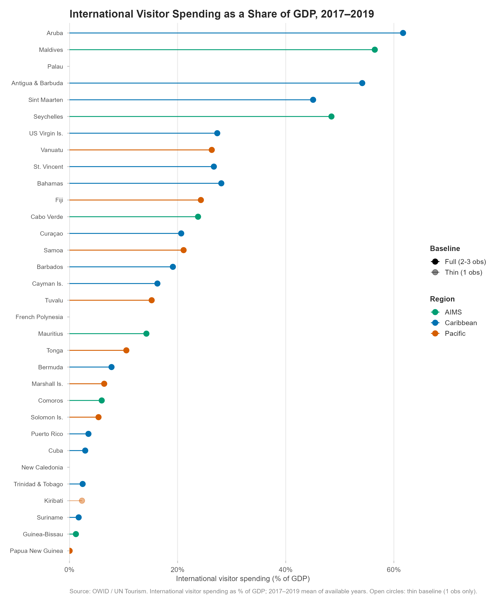
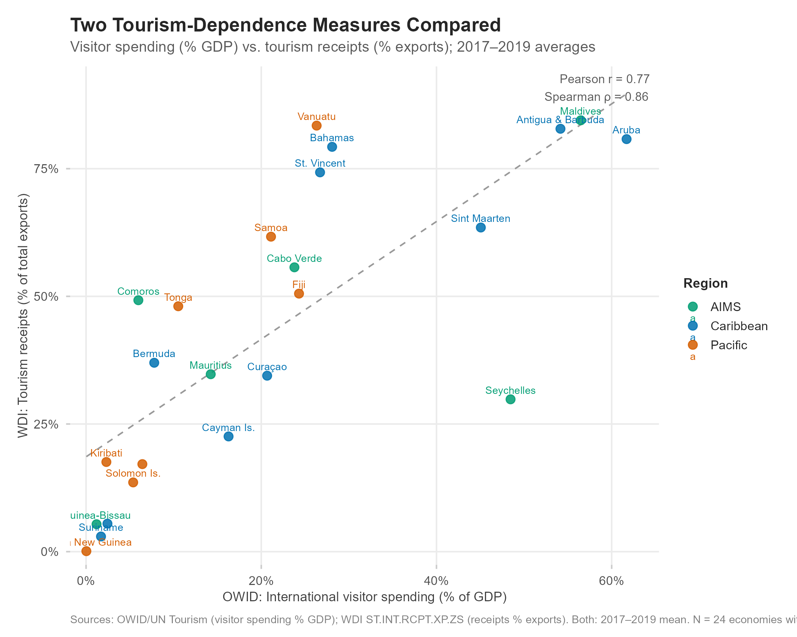
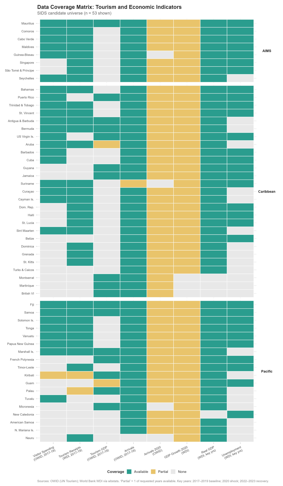
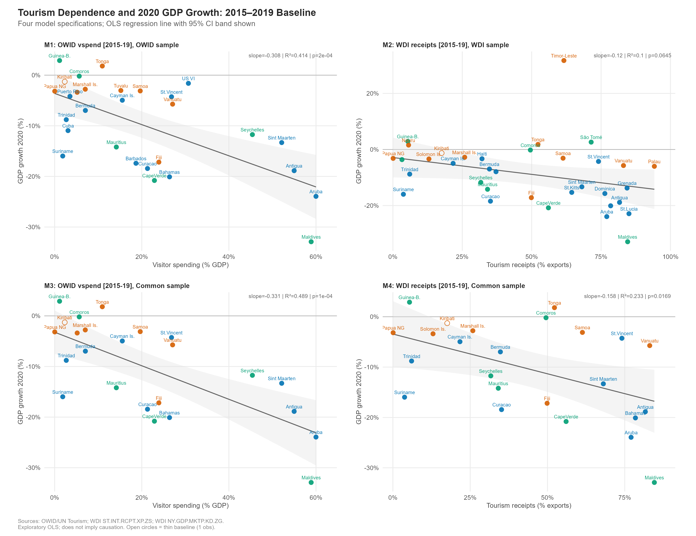
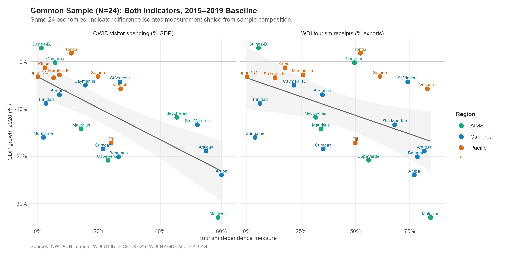

# Island Time, Interrupted

**Tourism Dependence and the COVID Cliff in Small Island Developing States**

*When international travel stopped, how did tourism-dependent island economies fare — and what happened next?*

🔗 [Explore the Project](https://johbry17.github.io/Island-Time-Interrupted/)

## Contents

- [Project Overview](#project-overview)
- [Published Site](#published-site)
- [Key Findings](#key-findings)
  - [The 2020 Shock](#the-2020-shock)
  - [The Recovery](#the-recovery)
- [Research Design at a Glance](#research-design-at-a-glance)
- [Figures](#figures)
- [Data Sources](#data-sources)
- [Tools](#tools)
- [Reproduction](#reproduction)
- [Repository Structure](#repository-structure)
- [Limitations](#limitations)
- [References](#references)
- [License](#license)
- [Author](#author)

## Project Overview

The COVID-19 pandemic interrupted international travel at a scale that turned an ordinary health crisis into an existential economic event for many small island states. This project asks a direct question: were the islands that depended most on tourism before the pandemic the ones that contracted most sharply in 2020?

For the best available measure of tourism dependence, the answer is yes. For the subsequent recovery, the answer is considerably messier.

## Published site

> **[johbry17.github.io/Island-Time-Interrupted](https://johbry17.github.io/Island-Time-Interrupted/)**

| Page | What it contains |
|------|-----------------|
| [Overview](https://johbry17.github.io/Island-Time-Interrupted/reports/overview.html) | The story: question, findings, implications |
| [Analysis](https://johbry17.github.io/Island-Time-Interrupted/reports/analysis.html) | All eight models, diagnostics, robustness checks, recovery |
| [Data Dictionary](https://johbry17.github.io/Island-Time-Interrupted/reports/data-dictionary.html) | Sources, indicators, variable definitions, coverage |
| [Methodology](https://johbry17.github.io/Island-Time-Interrupted/reports/methodology.html) | Research design, sample construction, decisions, limitations |

---

## Key Findings

### The 2020 shock

Each additional percentage point of pre-pandemic international visitor spending as a share of GDP was associated with approximately **0.31 percentage points lower 2020 real GDP growth** (OLS, N = 29, R² ≈ 0.414, raw p < 0.001; Holm-adjusted p = 0.001). This holds across two baseline windows, two samples, and after removing the most influential observation (Maldives, Cook's D ≈ 0.39).

The complementary indicator — WDI tourism receipts as a share of total exports — produces weaker results (R² ≈ 0.10 in the full WDI sample of 35, p ≈ 0.06). In the common 24-economy sample, the WDI indicator also produces a weaker relationship (R² = 0.233 versus 0.489 for OWID visitor spending), suggesting that the difference is not explained solely by sample composition. The choice of indicator matters substantively, not just methodologically.

### The recovery

By 2024, **21 of 28** economies with available data had returned to or exceeded their 2019 aggregate real GDP. **20 of 28** had recovered real GDP per capita.

Pre-pandemic tourism dependence was **not significantly associated** with the 2024 aggregate real GDP index (Pearson r = 0.21, p = 0.275, N = 28). Tourism-dependent economies experienced sharper contractions in 2020, followed by substantial rebounds from 2021. But the strength of the initial shock did not translate into a predictable ranking of recovery by 2024. Where economies stood in 2024 relative to 2019 reflects factors beyond pre-pandemic tourism dependence.

---

## Research Design at a Glance

| Element | Detail |
|---------|--------|
| Unit of Analysis | Economy; cross-sectional comparison |
| Candidate universe | 58 SIDS and associated economies (UN-OHRLLS list) |
| Primary shock sample | 29 economies (OWID vspend baseline + 2020 GDP growth) |
| Primary tourism measure | OWID visitor spending (% GDP), 2015–2019 average |
| Complementary measure | WDI tourism receipts (% total exports) |
| Shock outcome | 2020 real GDP growth (WDI NY.GDP.MKTP.KD.ZG) |
| Recovery measure | Real GDP index, 2019 = 100 (WDI NY.GDP.MKTP.KD) |
| Statistical approach | Bivariate OLS; Pearson and Spearman correlations |
| Principal models | 8: two indicators × two samples × two baseline windows |
| Model indicators | OWID visitor spending; WDI tourism receipts |
| Model samples | Indicator-specific full sample; 24-economy common sample |
| Model baselines | 	2015–2019; 2017–2019 |
| Multiple testing | Holm correction across all 8 p-values |
| Diagnostics | Cook's distance; coverage-restricted sensitivity |
| Primary recovery outcome | 	Aggregate real GDP index, 2019 = 100 |
| Recovery comparison | 2024; 28 of 29 economies |

---

## Figures

<!-- ### Tourism Dependence and Measurement -->

<!-- **Pre-pandemic international visitor spending.**



*International visitor spending varied enormously across economies. In Aruba and the Maldives, it exceeded 60% of GDP; in others, including Papua New Guinea and Guinea-Bissau, it represented a negligible share.* -->

<!-- **Comparing measures of tourism dependence.**



*International visitor spending as a share of GDP and tourism receipts as a share of total exports capture different dimensions of tourism dependence. The choice of indicator matters for the strength of the relationship with the 2020 economic shock.* -->

<!-- **Data coverage across candidate economies.**



*Coverage varies across indicators and economies. The candidate universe is broader than the samples available for the principal shock and recovery analyses.* -->

### The 2020 Economic Shock

**Tourism dependence and the 2020 economic contraction.**


*Economies where international visitor spending represented a larger share of GDP tended to experience deeper contractions in 2020. This is a cross-country association, not evidence that tourism dependence alone caused the decline.*

<!-- **The 2020 shock across model specifications.**



*The principal shock relationship across alternative tourism-dependence measures and analytical samples. Comparing specifications helps distinguish the influence of indicator choice from the influence of sample composition.* -->

<!-- **Comparing indicators in a common sample.**



*Restricting both indicators to the same 24 economies provides a more direct comparison. The OWID visitor-spending measure retains a stronger relationship with 2020 GDP growth than the WDI tourism-receipts measure.* -->

### Recovery

**Real GDP recovery trajectories, 2015–2025.**


*The rebound was not uniform. Most economies with available data had returned to or exceeded their 2019 aggregate output by 2024, but recovery paths differed considerably. Aggregate GDP recovery does not necessarily mean output per person has recovered.*

**Tourism dependence and the 2024 recovery endpoint.**


*Unlike the relationship observed for the 2020 shock, pre-pandemic tourism dependence was not significantly associated with the 2024 aggregate real GDP index (Pearson r = 0.21, p = 0.275, N = 28). The severity of the initial contraction did not reliably predict where economies stood five years later.*

---

## Data Sources

OWID CSVs are fixed downloads.  
WDI is retrieved dynamically through the API.  
Re-running the acquisition script may change the resulting analysis.  

| Dataset | Source | Coverage |
|---------|--------|----------|
| Visitor spending (% GDP) | [OWID / UN Tourism](https://ourworldindata.org/grapher/spending-by-international-visitors-while-visiting-a-country-as-a-share-of-gdp) | 1995–2024 |
| Tourism direct GDP (% GDP) | [OWID / UN Tourism](https://ourworldindata.org/grapher/tourism-gdp-proportion-of-total-gdp) | 2008–2023 |
| Tourist arrivals | [OWID / UN Tourism](https://ourworldindata.org/grapher/international-tourist-trips) | 1995–2024 |
| Tourism receipts (% exports) | [WDI ST.INT.RCPT.XP.ZS](https://data.worldbank.org/indicator/ST.INT.RCPT.XP.ZS) | 2008–2020† |
| Real GDP | [WDI NY.GDP.MKTP.KD](https://data.worldbank.org/indicator/NY.GDP.MKTP.KD) | 2008–2025 |
| Real GDP per capita | [WDI NY.GDP.PCAP.KD](https://data.worldbank.org/indicator/NY.GDP.PCAP.KD) | 2008–2025 |
| GDP growth | [WDI NY.GDP.MKTP.KD.ZG](https://data.worldbank.org/indicator/NY.GDP.MKTP.KD.ZG) | 2008–2025 |

† The WDI tourism receipts series contains no observations beyond 2020 in this retrieval. This likely reflects a change in UN Tourism's data dissemination approach rather than a simple publication lag.

> **Note on the visitor spending indicator:** OWID visitor spending (% GDP) is sourced from UN Tourism statistics and World Bank national accounts. It does not map to any single WDI indicator code. Do not attribute it to `ST.INT.XPND.GD.ZS` or conflate it with tourism direct GDP (SDG 8.9.1).

---

## Tools

- **R 4.4.1** — data acquisition, analysis, visualization
- **Quarto** — four-page reproducible HTML publication
- **GitHub Pages** — hosting from `docs/` directory
- **wbstats** — World Bank API retrieval
- **tidyverse / ggplot2 / patchwork** — data manipulation and figures
- **here / svglite / scales** — project paths, SVG export, formatting

---

## Reproduction

**Prerequisites**: R 4.4.1 (tested), Quarto 1.1 or later.

Install packages if needed:

```r
install.packages(c("tidyverse","wbstats","here","scales","knitr","rmarkdown","patchwork","svglite"))
```

Run from the **repository root** (`.git` location). The `here` package anchors all paths automatically.

```r
source("R/01_data_acquisition.R")   # ~2-3 min; calls World Bank API
source("R/02_data_quality.R")
source("R/03_preliminary_eda.R")
source("R/04_shock_models.R")
source("R/05_recovery_analysis.R")
```

Render the site:

```bash
quarto render
```

Output goes to `docs/`. Open `docs/index.html` to preview locally.

> Scripts must run before rendering. Quarto reads pre-computed files from `data/processed/` and `output/`; it does not re-execute the R pipeline at render time.

---

## Repository Structure

```
Island-Time-Interrupted/
├── _quarto.yml                 Site configuration (output: docs/)
├── LICENSE.md
├── LICENSE-CODE.md
│   
├── R/
│   ├── 01_data_acquisition.R
│   ├── 02_data_quality.R
│   ├── 03_preliminary_eda.R
│   ├── 04_shock_models.R
│   └── 05_recovery_analysis.R
│
├── data/
│   ├── raw/                OWID CSVs + WDI (worldbank/)
│   └── processed/          Analytical datasets
│       ├── candidates.csv
│       ├── analytical_panel.csv   (57 economies, unbalanced)
│       ├── country_coverage.csv
│       ├── baseline_shock_recovery.csv
│       └── recovery_index.csv
│
├── output/
│   ├── figures/            PNG (300 dpi) + SVG
│   └── tables/             CSV model and recovery results
│   
├── reports/                Quarto pages (public-facing narrative)
│   ├── images/             Favicon
│   ├── scripts/            JS 
│   └── themes/             SCSS themes
│
└── docs/                   Rendered site → GitHub Pages
```

---

## Limitations

1. **Observational, not causal.** Associations, not mechanisms. Confounders are not controlled.
2. **Small N.** Primary shock sample: 29 economies. Individual observations — particularly the Maldives — are influential.
3. **Annual GDP as outcome.** Aggregates the full calendar year; misses within-year variation, employment, debt, and inequality.
4. **WDI receipts end of series.** No observations beyond 2020; complementary analysis limited to the shock period.
5. **Coverage gaps.** Seven candidate economies (AIA, GLP, MTQ, MSR, BES, COK, NIU) have no World Bank API coverage, one of which (BES) has no OWID data. None qualifies for the shock or recovery samples.
6. **Recovery at 2024** covers 28 of 29 economies (VIR absent). 2025 data available for 22 only; not used for cross-country comparisons.

---

## References

- UN-OHRLLS. [List of Small Island Developing States](https://www.un.org/ohrlls/content/list-sids). Retrieved November 2026.
- Our World in Data. [Spending by international visitors as a share of GDP](https://ourworldindata.org/grapher/spending-by-international-visitors-while-visiting-a-country-as-a-share-of-gdp).
- World Bank. [World Development Indicators](https://datatopics.worldbank.org/world-development-indicators/).
- UN Tourism. [Tourism Statistics Database](https://www.untourism.int/tourism-statistics/tourism-statistics-database).

---

## License

Original written content, documentation, and visualizations are licensed under [CC BY 4.0](LICENSE.md). Source code is licensed separately under the [MIT License](LICENSE-CODE).

Third-party data and materials are subject to their respective licenses and terms of use:
- OWID data: [CC BY 4.0](https://creativecommons.org/licenses/by/4.0/)  
- World Bank WDI: [CC BY 4.0](https://datacatalog.worldbank.org/public-licenses#cc-by)  

## Author

Bryan Johns, November 2026  
[bryan.johns@informedwanderer.com](mailto:bryan.johns@informedwanderer.com) | [LinkedIn](https://www.linkedin.com/in/b-johns/) | [GitHub](https://github.com/johbry17) | [Portfolio](https://informedwanderer.com)  
— Fluent in Data. Fluent in Human.